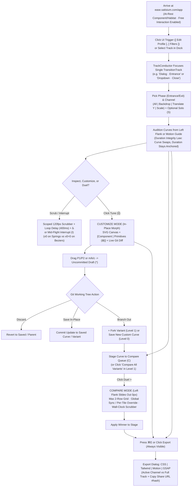

# Satisium Ease (`ease.satisium.com`)

## Definitive Master User Flow Narrative & Product Specification

> **Product Vision:** The Precision Motion Curve & Analytical Spring Physics Workstation for Modern UI Engineers.  
> **Core Workflow:** `Preview (Audition)` $\Rightarrow$ `Customize (Git Branching)` $\Rightarrow$ `Compare (Duel)` $\Rightarrow$ `Export`  
> **Core Tenet:** _"Everything is Code. Context is Premium. Educate, Don't Dictate."_  
> **Companion Spec:** [`EASE_ARCHITECTURE.md`](file:///home/satishkumar/Desktop/The%20Satisium%20Umbrella/ease/EASE_ARCHITECTURE.md)

---

## 0. Strict Product Boundaries (Non-Negotiables)

1. **Strictly Individual Curves & Component Choreography:** Ease focuses 100% on authoring, testing, branching, dueling, and exporting individual Bézier curves and analytical Springs on real UI components. _(Full-app Motion Design Systems belong to a separate future tool, `motion.satisium.com`, and are strictly out of scope here.)_
2. **In-Process Interactive Stages (Zero External URL / Localhost Iframes):** All preview components and interactive UI habitats run natively in-process—zero CORS/CSP blocks, zero `MutationObserver` feedback loops, and deterministic 120fps DOM-ref animation.
3. **Single-Page In-Place Morphing Shell (Zero Route Changes):** Transitioning between `Preview`, `Customize`, and `Compare` **never reloads or changes the page URL route**. Workspace Slabs/Blocks smoothly transform, slide out, or cross-fade their internal content in place.
4. **Always-Visible Anchors:** Across every mode (`Preview`, `Customize`, `Compare`), the **Brand Slab**, the **Bottom Timeline Scrubber Console**, the **`Export (⌘E)` trigger**, and the **`Sponsor Ad Card`** remain visible and accessible.

---

## 1. The Persona & Core Problem

- **Alex (Design Technologist & Frontend Engineer):** Building modern interfaces in Next.js, Tailwind CSS v4, Motion (`motion/react`), or GSAP.
- **The Problem:** Legacy tools (`cubic-bezier.com`, `easings.net`) evaluate motion on an isolated pink square or 20px dot in an empty void, forcing engineers to guess durations, overwrite timings blindly, and maintain disorganized one-off curves.
- **The Solution:** A single-page kinetic workstation where Alex can freely interact with real UI components, scope the scrubber onto one exact animation track, tune curves with Git-inspired branching and physics diffs, benchmark contenders side-by-side, and export production code in seconds.

---

## 2. Complete UI Region × Mode Architecture Matrix

Every block in the workstation has a deterministic layout and role across all 3 modes:

| Studio Block / Region            | Mode 1: **Preview (Audition)**                                                                                                                                                                                                                                     | Mode 2: **Customize (`Tune 🎚️`)**                                                                                                                                                                                                                                                                | Mode 3: **Compare (`Duel >`)**                                                                                                            |
| :------------------------------- | :----------------------------------------------------------------------------------------------------------------------------------------------------------------------------------------------------------------------------------------------------------------- | :----------------------------------------------------------------------------------------------------------------------------------------------------------------------------------------------------------------------------------------------------------------------------------------------- | :---------------------------------------------------------------------------------------------------------------------------------------- |
| **Top-Left: Brand Slab**         | Anchored (`Ease v1.0` • `⌘K` Search • Docs • Theme)                                                                                                                                                                                                                | Anchored                                                                                                                                                                                                                                                                                         | Anchored                                                                                                                                  |
| **Left Flank (Main)**            | **2-Level Sliding Cassette (`navStack: 0 \| 1`)**: • _Level 0:_ Pinned `Custom Curves` (`+N` variant badges) + `Bezier (31)` \| `Spring (25)` Library • _Level 1:_ Drilled-in Curve Branch View (`Main` + 2-col Variants + `Parent` lineage + Inline Rename) | **Stays Visible (`Level 0` or `Level 1`):** Lets user switch starting presets, manage branches, or save uncommitted drafts (`*`) as Variants or new Custom Curves                                                                                                                                | **Slides Completely Out (`0px`)**: Reclaims full horizontal space for side-by-side Duel tiles                                             |
| **Center Stage (Main)**          | Interactive Component / Habitat Viewport (`Desktop` \| `Tablet` \| `Mobile`) — freely clickable                                                                                                                                                                    | **Vertical Split:** • _Top (~58%):_ Dotted-Grid Auto-Zoom SVG Canvas (`P1/P2` or Spring wave + Velocity Slope $dx/dt$ + Numeric Handle Inputs + `Parse`) • _Bottom (~42%):_ Live Preview with `[ Component \| Primitives (⊞) ]` toggle (`Position`, `Scale`, `Opacity`, `Rotate`, `All 4`) | **Expanded Dynamic Tile Grid:** `N` tiles matching active checked curves in Compare Queue (**Max 2 Rows**; horizontal scroll if overflow) |
| **Center Dock (Above Scrubber)** | Active Component/Track Picker • `Entrance \| Exit` • Channel Strip (`All` + channels + `Solo (S)`) • `Pin (📌)` • `Reset` • `Tune (🎚️)` • `Stage (C)`                                                                                                              | Shows Engine (`Bezier \| Spring`), `Duration (ms)` / `ts`, Git Working Tree controls (`Revert`, `Commit`, `+ Fork Variant`), & `Back to Preview`                                                                                                                                                 | Shows Global Target Sync Bar (`Component + Track + Channel`), `Trigger All (Space)`, `Interrupt (I)`, & `Exit Duel`                       |
| **Bottom Scrubber Console**      | **Anchored:** Scoped strictly to active `TransitionTrack` (`0ms → maxMs`) • `Play/Pause` • `Loop (L)` + `Loop Delay (400ms)` • `1x / 0.5x / 0.25x` • `Reduced Motion (♿)`                                                                                         | **Anchored:** Scrubs **both** the SVG Curve Playhead Dot and Bottom Preview in 120fps lockstep                                                                                                                                                                                                   | **Anchored:** Wall-clock `elapsedMs` scrubber (`0ms → maxTileDurationMs`) driving all Duel tiles simultaneously                           |
| **Right Flank: Top Card**        | **Motion Guide:** Semantic role guidance tailored to `Component + Phase + Channel`, plus 1-click Recommended Entrance/Exit pills                                                                                                                                   | **Morphs to Physics Telemetry & Git Diff:** Live $\zeta$, $t_s$, $t_{95}$, Peak Velocity, Overshoot %, `Best Use Cases`, & **Diff vs. Parent / Saved**                                                                                                                                           | **Morphs to Duel Delta Telemetry:** Ranked $t_{95}$ arrival, Peak Velocity, $t_s$, & Settle Delta across visible Duel tiles               |
| **Right Flank: Middle Card**     | **Compare Queue:** `+ Queue Current (C)` + `Duel >`                                                                                                                                                                                                                | **Remains Visible:** Queue current draft or saved curve (`C`)                                                                                                                                                                                                                                    | **Compare Queue Controls:** Toggle tile visibility (`👁️` / Checkbox), reorder, remove, `Exit Duel`                                        |
| **Right Flank: Bottom Pair**     | **`Export (⌘E)`** + **`Sponsor Ad Card`** _(Always Visible)_                                                                                                                                                                                                       | **`Export (⌘E)`** + **`Sponsor Ad Card`** _(Always Visible)_                                                                                                                                                                                                                                     | **`Export (⌘E)`** + **`Sponsor Ad Card`** _(Always Visible)_                                                                              |

---

## 3. End-to-End Workstation Flow Diagram

---

## 4. Act 1: Calm Arrival, Free Interaction & Scoped Track Targeting

Alex opens `ease.satisium.com/app`.

### 1. Calm At-Rest Arrival (The Real-World Trigger Law)

- **Zero Auto-Looping Chaos:** On arrival, the stage rests calmly in a natural state (e.g., an interactive workspace or a Dialog trigger button `[ Edit Profile ]`). Motion never flashes endlessly on load.
- **Two Ways to Trigger:**
  1. **Free Natural Interaction:** Alex clicks buttons, opens dropdowns, toggles tabs, or opens/closes dialogs freely at real-time `1x` speed.
  2. **Ergonomic `Spacebar` Trigger:** Tapping `Spacebar` triggers the primary interaction of the currently focused track without moving the mouse away from controls.

### 2. Scoped Single-Animation Targeting (`Auto-Capture` + `Pin`)

In a multi-widget preview (e.g., a mini-dashboard with a Filter Dropdown, Tabs, and Modal), **Play (`▶`)** and the **Bottom Scrubber** NEVER animate the whole dashboard at once:

- **Discrete `TransitionTracks`:** Every animatable transition is registered as an isolated track (`dropdown:open`, `dropdown:close`, `dialog:open`, `dialog:close`, `tabs:switch`).
- **Auto-Capture:** When Alex clicks `[ Filters ]` to open the Dropdown, the `TrackConductor` automatically sets **`dropdown:open`** as the focused track in the Center Dock and Right Flank (unless pinned elsewhere).
- **Scoped Scrubbing & Mount/Unmount Protection:** Dragging the Scrubber or clicking Play animates **ONLY `dropdown:open`**, freezing all other widgets calmly. Even if the Dropdown is currently closed—or if Alex switches to `dropdown:close` and scrubs backward from `100% → 40%`—the component force-stays mounted in the DOM at that exact frame so exit animations never vanish mid-scrub.
- **Manual `Pin (📌)`:** Clicking `Pin` locks the Scrubber onto a chosen track (e.g., `dialog:open`) even while Alex clicks other buttons in the stage.

---

## 5. Act 2: Preview (Audition) Mode & The 2-Tier Git Cassette

Alex focuses on **`Dialog · Entrance`** to craft how a modal opens.

### 1. Left Flank: 2-Tier Git-Inspired Catalog (`navStack: 0 | 1`)

- **Level 0 (Catalog):**
  - Top section displays pinned **`Custom Curves`** in a 3-column squircle grid (e.g., `Modal Sheet (+3)`, `Drawer Physics (+2)`), each rendering a real mini SVG curve thumbnail and variant count badge.
  - Below sits the immutable **`Library`**: **`Bezier (31)`** | **`Spring (25)`** tabs, search bar, and category filters (`All` | `Popular`).
  - **Single Click:** Immediately auditions that curve on the active stage track without changing view.
  - **Double Click (or Hover `↗` Inspect icon):** On a Custom Curve, slides the Left Flank smoothly to **Level 1** (`navStack = 1`). On a Library Preset, opens its quick fork/inspect prompt or forks into Level 1.
- **Level 1 (Curve Branch View — `< Presets` Back Button):**
  - Displays the Root Custom Curve (`Modal Sheet [Main]`) with **zero-modal inline renaming** (click title or pencil icon $\rightarrow$ `<h3>` becomes an `<input>`, `Enter` saves, `Esc` cancels) and its **Parent Lineage** (`Forked from: Apple Fluid Decel`).
  - Displays a 2-column grid of its **Variants** (e.g., `Exit`, `Expressive`, `Subdued`) plus a **`+ Add Variant`** tile.
  - **Clean Git Actions:**
    - **`Compare All Variants`:** 1-click sends `Main` + all its Variants directly into the **Compare Queue** and launches Duel Mode!
    - **`Promote Variant to Root`:** Cleanly detaches and moves a Variant up to Level 0 as its own standalone Root Custom Curve (zero duplicate ghost copies left behind).
    - **Hover Trash (`Delete`) with Safe Fallback:** Deleting a variant falls back selection to its parent root; deleting a root curve cascades to its variants and safely falls back selection to the next custom curve or default preset.

### 2. Multi-Channel Strip & Smart `All` Routing

In the Center Dock for `Dialog · Entrance`, Alex sees decoupled property channels:

- `All` | `Backdrop (opacity: 0 → 0.5, 180ms)` | `Translate Y (28px → 0px, 280ms)` | `Scale (0.94 → 1.0, 280ms)`
- **Smart `All` Routing:** Clicking a bouncy spring while `All` is selected applies that spring to `Translate Y` and `Scale`, while automatically keeping `Backdrop` opacity non-overshooting and clamped to `[0, 1]` so the backdrop scrim never flickers. Clicking `Backdrop` directly allows full manual override (_"Educate, Don't Dictate"_).
- **`Entrance | Exit` Toggle:** Switching to `Exit` targets the dismissal track (`180ms` default) and updates the Right Flank's recommendations.

### 3. The Duration Integrity Law

Alex selects `Translate Y` (currently choreographed at **`280ms`**).

- **Strict Rule:** Clicking any Bézier preset in the Left Library or Motion Guide **ONLY updates the easing curve shape (`p1, p2`)—it NEVER overwrites `280ms`**. Multi-channel choreography stays synchronized.
- **When Selecting a Spring Preset:**
  - The channel safely preserves `savedBezierDurationMs = 280ms` in memory (restoring `280ms` if Alex switches back to a Bézier).
  - By default (**Perceptual-Fit Mode**), Ease maps the spring's damping character cleanly to the `280ms` window ($k = (2\pi / T)^2, c = 2\zeta\sqrt{km}$) so component timing doesn't break—OR Alex can toggle **Natural Physics Mode** to let the spring run at its raw physical settle time $t_s$ (`⚡ Natural Settle: 230ms`).

### 4. `Solo (S)`, `Loop (L) + Loop Delay`, `0.25x`, `♿` & Mid-Flight `Interrupt (I)`

- **`Solo (S)`:** Isolates the selected channel (`Scale` `0.94 → 1.0`) while locking `Backdrop: 1.0` and `Translate Y: 0px`—and keeps the component open/visible even when soloing an `Exit` channel!
- **`Loop (L)` + `Loop Delay`:** Disabled (`OFF`) by default. When toggled `ON`, replays the targeted track repeatedly with a configurable **Loop Delay rest gap (`400ms` default)** so consecutive animations never blur together.
- **120fps Scrubber + `0.5x / 0.25x` + `♿`:** Scrubs DOM refs directly at 120fps (zero React frame re-renders), and `♿` previews OS Reduced Motion (collapsing spatial movement into a calm opacity fade).
- **`Interrupt (I)` Stress Test:** Interrupts the track mid-flight—simulating **true velocity-preserving ($v_0$) momentum carry-over on Springs** vs. **position-only reversal ($v_0 = 0$) on Béziers**.

---

## 6. Act 3: Customize Mode (`Tune 🎚️`) — SVG Studio, Primitives X-Ray & Working Tree (`*`)

Alex clicks **`Tune (🎚️)`** in the Center Dock to sculpt a custom curve.

### 1. In-Place Workspace Morph

- **Left Flank:** Stays open (`Level 0` or `Level 1` Git Branch View).
- **Center Stage Splits Vertically:**
  - **Top (~58%) — Dotted-Grid SVG Math Canvas:**
    - _Bézier Mode:_ Draggable `P1` / `P2` handles (30px hit targets), **Dynamic Auto-Zoom ViewBox** (automatically expands vertically with buffer margin whenever handles or overshoots go outside `[0, 1]`), toggleable cyan **Velocity Derivative slope ($dx/dt$)**, `Start Handle / End Handle` numeric inputs, Arrow-key micro-nudging, and a `Parse / Import` bar (`cubic-bezier(...)`, `[x1,y1,x2,y2]`, or spring strings).
    - _Spring Mode:_ Dotted-grid analytical spring wave with **Simple (`Duration + Bounce`)** or **Raw Physics (`Mass`, `Stiffness`, `Damping`)** controls.
    - **Synced Playhead Dot:** Scrubbing the Bottom Scrubber moves a glowing dot directly along the SVG curve at 120fps in sync with the preview below.
  - **Bottom (~42%) — Live Micro-Preview (`[ Component | Primitives (⊞) ]`):**
    - **Default (`[ Component ]`):** Shows the active targeted component (`Dialog · Entrance · Scale`) reacting live as handles move.
    - **1-Click Toggle (`[ Primitives (⊞) ]`):** Switches to the classic 4-track X-Ray (**`Position [→]`**, **`Scale [⛶]`**, **`Opacity [👁️]`**, **`Rotate [↻]`**, or **`All 4 [⊞]`**) so Alex can inspect universal behavior across every CSS transform at once.
- **Right Flank (Top Card) Morphs to Live Telemetry & Git Diff:**
  - Displays real-time $\zeta$, $t_s$, $t_{95}$, Peak Velocity, Overshoot %, `Best Use Cases`, and **Git Diff vs. Parent / Saved** (e.g., `"+0.14 initial pull · -37ms faster t95 · +1.9% soft overshoot"`).

### 2. Uncommitted Draft (`*`) & Git Actions

- **Non-Destructive Working Tree:** Dragging any handle or spring slider never silently overwrites saved data. It creates an **Uncommitted Draft (`*`)** state (`Modal Sheet *` or `Ease Out Quart *`).
- **3 Clean Working-Tree Actions:**
  1. **`Revert` (`git checkout`):** Discards the draft and snaps cleanly back to the saved curve/preset.
  2. **`Commit / Update`:** Saves changes directly into the active Custom Curve or Variant _(disabled on immutable Library Presets)_.
  3. **`+ Fork Variant` / `Save as New Custom Curve`:** Commits the draft as a brand-new Variant branch under the active Custom Curve (or forks an immutable Library Preset into a new Level 0 Custom Curve with `parentPreset` lineage).

---

## 7. Act 4: Compare (Duel) Mode — Left Collapse, Dynamic Grid & Wall-Clock Scrubber

Alex stages **`Ease Out Quart (280ms)`** and a custom **`Snappy Spring` ($m=1, k=860, c=46 \rightarrow \zeta=0.784, t_s=230\text{ms}, \text{overshoot } 1.9\%$)** using **`C`**, then clicks **`Duel >`**.

### 1. In-Place Workspace Morph

- **Left Flank:** Slides completely **out (`0px`)**.
- **Center Stage:** Expands leftward into the full available width.
- **Right Flank & Bottom Scrubber:** Remain anchored and visible.

### 2. Dynamic Tile Grid & Targeting

- **Queue-Driven Tiles (`Max 2 Rows`):** Renders 1 tile per active checked curve in the Compare Queue (`2–3` in 1 row; `4+` in 2 rows). If more tiles are active than fit at `min-width: 340px`, the 2-row grid scrolls horizontally—while checkboxes/eye toggles in the Right Flank's `Compare Queue` let Alex show/hide specific contenders cleanly (2–4 ideal for human comparison).
- **Global Target Sync + Per-Tile Override:**
  - The Compare Dock's **Global Target Bar** (`Dialog · Entrance · Scale`) switches **all tiles together** by default for fair benchmarking.
  - Each tile header has an optional **Override (`Unlink ▾`)** selector to test a different component or channel on that single tile if desired.

### 3. Synchronized Playback, Wall-Clock Scrubber & Honest Telemetry

- **Trigger All (`Spacebar`) & `Interrupt (I)`:** Fires all tiles simultaneously on the exact same millisecond.
- **Wall-Clock `elapsedMs` Scrubber:** Scrubs from `0ms` to `max(all tile durations)` (`280ms`). At `230ms`, `Snappy Spring` is already settled at rest while `Ease Out Quart` finishes its final `50ms` tail—providing 100% truthful speed comparisons.
- **Right Flank Top Card (Duel Delta Telemetry):**
  - _Tile A (`Ease Out Quart`, `280ms`):_ **$t\_{95}$ Arrival: `149ms`** · Peak Velocity: `2.8x` · Overshoot: `0%` · Settles: `280ms`.
  - _Tile B (`Snappy Spring`, $m=1, k=860, c=46$):_ **$t\_{95}$ Arrival: `112ms`** (`37ms` faster arrival) · Peak Velocity: `3.6x` · Overshoot: `1.9%` · Natural Settle $t_s$: `230ms`.
- Alex clicks **`Apply to Stage`** on the winning tile and exits via **`Exit Duel`** or **`Esc`**.

---

## 8. Act 5: Export Dialog (`⌘E`) & URL Hash Collaboration

From any mode (`Preview`, `Customize`, or `Compare`), clicking the always-visible **`Export (⌘E)`** button opens the **Export Dialog**:

- **Scope Switch:** **`Active Channel`** (single curve snippet) vs. **`Full Component Track`** (all channels of the active transition, e.g., `Backdrop + Translate Y + Scale`).
- **4 Clean Framework Tabs:**
  1. **`CSS`:** Outputs `cubic-bezier(...)` or compiled `linear(...)` spring transition paired with exact duration/settle `ms`.
  2. **`Tailwind`:** Outputs Tailwind v4 utility classes (`duration-[230ms] ease-[linear(0,0.36_12%,0.89_30%,1.019_52%,1.002_76%,1)]`).
  3. **`Motion`:** Outputs typed `motion/react` transition props (`{ type: "spring", mass: 1, stiffness: 860, damping: 46 }` or `[x1, y1, x2, y2]` array).
  4. **`GSAP`:** Outputs `cubic-bezier` / Power eases for Béziers, or compiles springs into a real **`CustomEase.create(...)`** SVG path with `overwrite: "auto"` (never substituting fake eases).
- **URL Hash Share (`Copy Share URL`):** Encodes complete stage + math state (`#a=dialog&t=dialog:open&p=enter&ch=scale&e=spring&m=1&k=860&c=46&d=230`) so teammates open the exact same component, channel, and curve.

---

## 9. Complete Keyboard Shortcut Reference

| Shortcut         | Context                      | Action                                                                               |
| :--------------- | :--------------------------- | :----------------------------------------------------------------------------------- |
| **`Spacebar`**   | Global (outside text inputs) | Fires primary trigger of active `TransitionTrack` (or all tiles in Compare Mode)     |
| **`I`**          | Preview / Compare            | Triggers **Mid-Flight Interrupt** ($v_0$ preserved on Springs; $v_0=0$ on Béziers)   |
| **`L`**          | Preview / Customize          | Toggles **Loop Mode** (`OFF` by default) with `Loop Delay` breather                  |
| **`S`**          | Preview                      | Toggles **Solo Channel** isolation (keeps UI visible even during `Exit`)             |
| **`C`**          | Preview / Customize          | Stages active curve into **Compare Queue**                                           |
| **`⌘E`**         | Any Mode                     | Opens / closes **Export Dialog** (`CSS`, `Tailwind`, `Motion`, `GSAP`, `Share URL`)  |
| **`⌘K`**         | Any Mode                     | Opens **Command Search** across presets, custom curves, and components               |
| **`Esc`**        | Any Mode                     | Closes Export Dialog, cancels inline rename, exits Customize/Compare back to Preview |
| **`Arrow Keys`** | Customize (Handle focused)   | Nudges Bézier handle by `0.01` (`Shift + Arrow` by `0.05`)                           |
